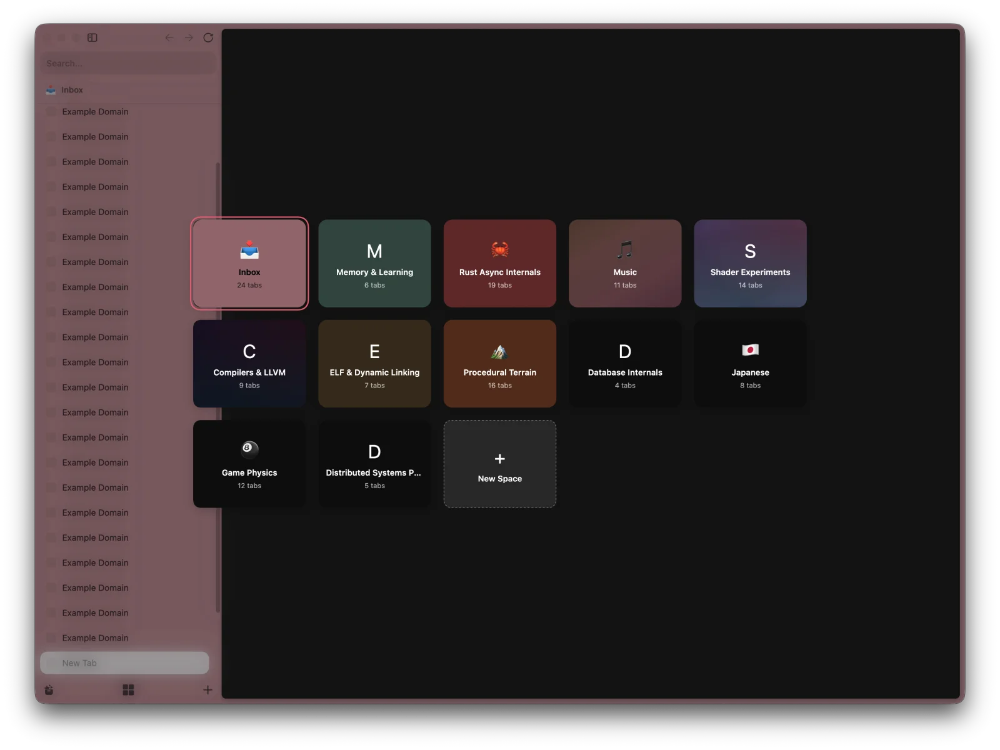

# Zen Better Spaces

Replaces the space switcher at the bottom of [Zen Browser](https://zen-browser.app)'s sidebar with a full-window spaces view.

- Every space shows up as a tile with its icon, name, theme gradient and tab count.
- Open the view with the Spaces button in the sidebar footer or cmd+E.
- Click a space or press Enter to switch to it. Arrow keys move between spaces, and Escape or a click outside closes the view.
- The last tile creates a new space.

The install scripts are macOS only for now.

## Install

1. Quit Zen.
2. Run `./install.sh`. It copies two files into `Zen.app` and links `JS/`, `resources/` and the [fx-autoconfig](https://github.com/MrOtherGuy/fx-autoconfig) loader into the default Zen profile's `chrome` folder.
3. Start Zen.

If the copy into `Zen.app` fails with "Operation not permitted", give your terminal App Management access in System Settings > Privacy & Security, then run it again.

Zen updates replace the app bundle, so rerun `install.sh` after each update. `uninstall.sh` removes everything it added.

## Working on scripts

- Scripts live in `JS/` and load into every browser window at startup. Changes need a Zen restart, and new or renamed files also need the startup cache cleared: Tools > userScripts > Restart now and clear startup cache.
- `console.log` from scripts shows up in the Browser Console (cmd+shift+J).
- Files in `resources/` are served at `chrome://userchrome/content/`.
